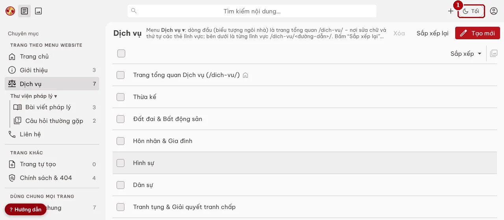
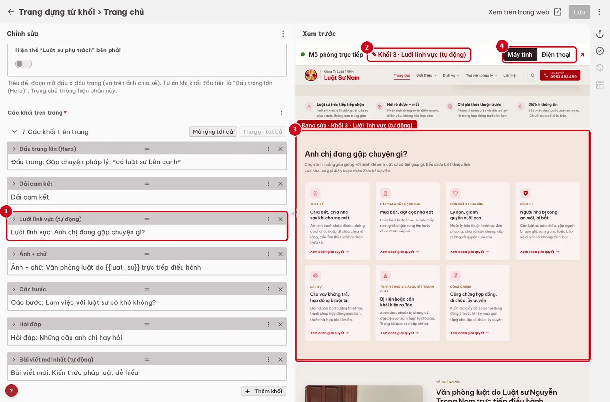
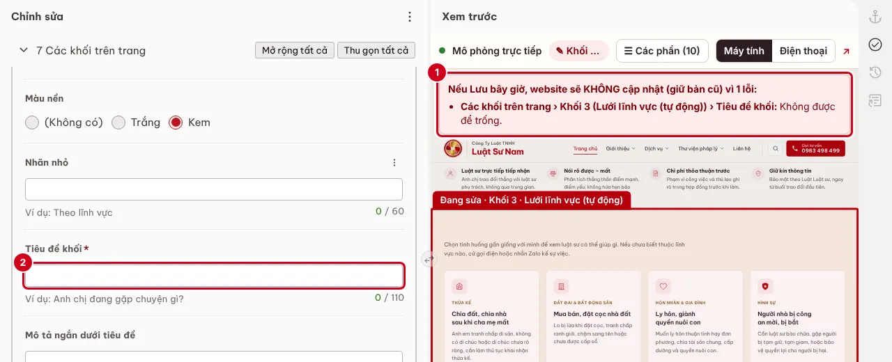

# Hướng dẫn sử dụng trang quản trị – Luật Sư Nam

Mọi việc sửa nội dung làm tại **[willmichco.github.io/luatsunam/admin](https://willmichco.github.io/luatsunam/admin/)**, không cần biết code, không cần vào GitHub.
Bấm **Lưu** → website tự cập nhật sau **1–3 phút**. Nhập sai → website **giữ nguyên bản cũ**, quản trị nhận email báo lỗi.
Trong trang quản trị luôn có nút **? Hướng dẫn** ở góc dưới bên trái để mở lại trang này.
Người mới: làm [4 bài tập làm quen](../bai-tap/) (có bấm giờ, không ảnh hưởng website) trước khi sửa nội dung thật.

> **Luôn bấm Lưu trước khi rời khung soạn thảo.** Trang quản trị không tự lưu bản đang soạn. Nếu bấm Esc, nút ← hoặc đóng tab khi còn thay đổi chưa lưu, trang sẽ hỏi lại. Bài dài nên soạn trong Word/Google Docs rồi dán vào, và bấm Lưu mỗi 10 phút (bài vẫn là nháp nên chưa lên site).

**Tìm chỗ cần sửa:** cột trái xếp đúng như menu trên website, từ trái sang phải; phần dùng chung cho mọi trang nằm cuối.



| Trên website | Sửa ở cột trái |
|---|---|
| Trang chủ | **Trang chủ** – bấm là mở ngay |
| Giới thiệu ▾ (Về Luật Sư Nam, Vì sao chọn chúng tôi, Quy trình làm việc) | **Giới thiệu** → chọn 1 trong 3 trang |
| Dịch vụ ▾ | **Dịch vụ** → dòng đầu (biểu tượng ngôi nhà) là trang tổng quan /dich-vu/, bên dưới là từng lĩnh vực |
| Thư viện pháp lý ▾ → Bài viết pháp lý | **Bài viết pháp lý** → dòng đầu là trang danh sách bài, bên dưới là từng bài |
| Thư viện pháp lý ▾ → Câu hỏi thường gặp | **Câu hỏi thường gặp** → phần chữ của trang, hoặc kho câu hỏi |
| Liên hệ | **Liên hệ** – bấm là mở ngay |
| Chính sách bảo mật, Điều khoản, Miễn trừ (cuối chân trang), trang lỗi 404 | **Chính sách & 404** |
| Trang mới tự tạo | **Trang tự tạo** |
| Hotline, địa chỉ, giờ làm việc, menu, chân trang, logo – hiện trên mọi trang | **Cài đặt chung** |

Nút **Tối / Sáng** (1) ở góc phải trên đổi giao diện tối hoặc sáng (trình duyệt nhớ lựa chọn).

## 1. Đăng nhập

**Biên tập viên:** bấm **Đăng nhập bằng GitHub** (1). Lần đầu GitHub hỏi cấp quyền: bấm *Authorize*. Chưa có tài khoản: xem [mục 11](#tao-tai-khoan-github).


**Quản trị, trong lúc chưa cài Worker đăng nhập:** dùng *mã truy cập* (tạo 1 lần, khoảng 3 phút):

1. github.com → ảnh đại diện → **Settings** → **Developer settings** → **Personal access tokens** → **Fine-grained tokens** → **Generate new token**.
2. *Token name* `CMS Luật Sư Nam` · *Expiration* 90 ngày · *Repository access* **Only select repositories** → `luatsunam` · *Permissions* → *Repository permissions* → **Contents: Read and write** → **Generate token** → chép mã (bắt đầu bằng `github_pat_`).
3. Mở /admin → **Đăng nhập bằng mã truy cập** (1) → dán mã (2) → **Đăng nhập** (3).


> Mã truy cập như chìa khóa văn phòng: không gửi qua Zalo/email, không lưu trên máy công cộng (dùng xong: ảnh đại diện góc phải trên → Đăng xuất). Hết hạn thì tạo mã mới.

## 2. Khung mô phỏng – thấy ngay đang sửa chỗ nào

Khi mở một bài/trang, nửa phải màn hình là **Xem trước**: trang web dựng bằng đúng bộ build của site, cập nhật sau khoảng 0,3 giây mỗi lần gõ – chưa cần bấm Lưu.



- **Trang này gồm những phần nào:** nút **☰ Các phần** (4) mở danh sách mọi phần sửa được của trang (1), theo thứ tự từ trên xuống; số đỏ trên trang mô phỏng khớp với số trong danh sách. Bấm một phần → form bên trái mở đúng ô đó (2). Phần số xám (đầu trang, chân trang) dùng chung mọi trang: bấm nút bên dưới nó để mở đúng mục trong **Cài đặt chung**. Cuối danh sách là các ô **không hiện trên trang này** (SEO, mô tả ngắn hiện ở trang khác…).
- Bấm hoặc rê chuột vào một khối/ô bên trái → nhãn **✎ Đang sửa** ghi tên phần đó, và trang bên phải cuộn tới, **đóng khung đỏ** đúng chỗ (3). Rê chuột qua khối khác: khung nét đứt cho biết khối đó nằm đâu.
- Ngược lại: **bấm vào một chỗ trên trang mô phỏng** → form bên trái mở đúng khối/ô đó. Bấm link trong mô phỏng không rời trang quản trị.
- **Máy tính / Điện thoại** (5): xem bố cục 390 px như trên điện thoại. Nút ↗ mở trang thật trên website (bản đã lưu).
- Khối đang tắt *Hiển thị khối này* vẫn hiện mờ kèm nhãn **Đang ẩn – không hiện trên website**.
- Khi sửa ô SEO, phía trên mô phỏng có **mẫu kết quả Google** kèm số ký tự.

Nếu nội dung đang có lỗi, khung đỏ phía trên liệt kê từng lỗi (1) – **Lưu lúc này thì website giữ bản cũ**. Sửa ô báo lỗi (2) đến khi khung đỏ biến mất rồi mới Lưu.



> Lần đầu mở trong ngày, khung mô phỏng cần **5–15 giây** để tải bộ dựng trang (khoảng 10 MB, từ lần sau trình duyệt dùng lại). Cần có mạng. Nếu khung báo lỗi tải, vẫn soạn và Lưu bình thường – kiểm tra lại trên site sau 1–3 phút.

## 3. Đăng bài

Khoảng 15 phút, chưa tính thời gian luật sư duyệt.

1. **Bài viết pháp lý** → **Tạo mới** (1).

   

2. Điền **Tiêu đề** (1) và **Đường dẫn** (2): 2–8 từ khóa không dấu nối bằng gạch ngang, ví dụ `hop-dong-dat-coc-mua-nha`. Đường dẫn **không đổi được sau khi lưu**. Giữ nguyên **Bản nháp** (3). Chọn **Lĩnh vực chính** (4).

   

3. Điền **Tóm tắt trên thẻ**, 3–4 ý **Tóm tắt nhanh** (bấm *+ Thêm ý*), **Đoạn dẫn đầu bài**.
4. **Nội dung bài viết**: dán thân bài. Nút **¶** (1) → *Tiêu đề 2* cho mục chính (tự vào mục lục), *Tiêu đề 3* cho mục nhỏ, *Trích dẫn* = hộp lưu ý. Nút **Chèn** (2) → **Ảnh** hoặc **Bảng**.

   

5. **Ảnh:** trong khung ảnh bấm *Duyệt tệp* → **Tải lên** (1) → chọn ảnh trong máy (≤ 5 MB, tự đổi sang WebP) → **Chèn**.

   

   Điền **Mô tả ảnh** (1) – bắt buộc, thiếu thì không lưu được – và **Chú thích dưới ảnh** (2) nếu cần.

   

6. **SEO:** *Tiêu đề trên Google* (1) 15–60 ký tự, *Mô tả trên Google* (2) 70–160 ký tự – bộ đếm hiện số ký tự, xanh là đạt. Bấm **Lưu** (3).

   

7. Bài đã lưu hiện trong danh sách kèm chữ **BẢN NHÁP** – chưa lên site.

   

8. Khung mô phỏng bên phải đã cho thấy bài như trên site (có dải BẢN NHÁP). Gửi luật sư phụ trách link xem trước `/nhap/<đường-dẫn>/` (trên bản thử Cloudflare, khi đã cài). Luật sư duyệt → bỏ dấu **Bản nháp** → **Lưu** → bài lên site sau 1–3 phút.
9. Mở bài trên site kiểm tra, cả trên điện thoại; Google Search Console → *Kiểm tra URL* → *Yêu cầu lập chỉ mục*.

> **Bảng:** Chèn → Bảng; mỗi dòng một hàng, các ô cách nhau dấu `|`, dòng đầu là tiêu đề cột. **Liên kết trong site:** bôi đen chữ → nút liên kết → dán `/dich-vu/thua-ke/`.

## 4. Thêm khối

Thêm, xóa, đổi thứ tự, tạm ẩn các phần (section) của một trang – khoảng 5 phút.

1. Ở cột trái chọn trang (ví dụ **Trang chủ**, hoặc **Giới thiệu** → *Vì sao chọn chúng tôi*) → mục **Các khối trên trang**. Mẹo: bấm **☰ Các phần** ở khung mô phỏng rồi bấm thẳng vào khối muốn sửa.
2. Giữ chuột vào **═** (1) rồi kéo để đổi thứ tự. **×** (2) để xóa khối. **Thêm khối** (3) → chọn loại khối → điền nội dung.

   

   

3. Muốn tạm ẩn, **đừng xóa**: bấm vào khối để mở → tắt **Hiển thị khối này** (1).

   

4. **Lưu** → kiểm tra trên site sau 1–3 phút, cả trên điện thoại.

> **Lỡ xóa hoặc sửa nhầm (chưa lưu):** nút **⋮** góc phải trên → **Hoàn tác tất cả thay đổi**. Đã lưu rồi: báo quản trị (mọi lần lưu đều có lịch sử, lấy lại được).

## 5. Tạo trang

Khoảng 20 phút.

1. **Trang tự tạo** → **Tạo mới** → **Tên trang** (1), giữ **Bản nháp** (2), **Nằm trong mục** (3) nếu là trang con, **Tiêu đề lớn của trang** (4).

   

2. Thêm khối như [mục 4](#them-khoi) – thường dùng *Đoạn văn tự do*, *Lưới thẻ*, *Hỏi đáp*. Khối liên hệ đỏ cuối trang có sẵn.
3. Điền **SEO** → **Lưu**. Duyệt xong → bỏ dấu **Bản nháp** → **Lưu**.
4. **Đưa lên menu:** chờ 2–3 phút cho website build xong, **tải lại trang quản trị (F5)** để trang mới có trong danh sách chọn. **Cài đặt chung → Menu và chân trang** → mở mục cha (ví dụ *Giới thiệu ▾*) → **Thêm mục con** → điền **Chữ** (1) → chọn **Trang** (2) → **Lưu**.

   

## 6. Đổi hotline

**Cài đặt chung → Thông tin công ty** → sửa **Hotline** (1) → **Lưu**. Tự cập nhật trên mọi trang: nút Gọi, nút Zalo, chân trang, bản đồ, mô tả trên Google, dữ liệu cho Google.


- Ô **Liên kết Zalo** để trống thì Zalo tự theo hotline; chỉ điền khi Zalo dùng số khác.
- Trong mọi ô chữ, viết mã `{{hotline}}`, `{{email}}`, `{{luat_su}}`, `{{dia_chi}}`, `{{gio_lam_viec}}` thay vì gõ số hoặc tên. Gõ thẳng số hotline/email: build báo lỗi và chỉ đúng ô cần sửa.

## 7. Chuyển hướng

Dùng khi phải đổi đường dẫn của trang/bài đã đăng (hiếm khi cần, vì làm mất thứ hạng tạm thời).

1. Tạo trang/bài mới với đường dẫn mới, chép nội dung sang, đăng.
2. **Cài đặt chung → Chuyển hướng 301** → **Thêm chuyển hướng** → **Đường dẫn cũ** (1) dạng `/duong-dan-cu/` → **Chuyển tới** (2) dạng `/duong-dan-moi/` → **Lưu**.

   

3. Xóa trang/bài cũ → **Lưu**. Build tự kiểm: đích phải có thật, không vòng lặp.

## 8. Khi build lỗi

Dấu hiệu: đã bấm Lưu 5 phút mà website chưa đổi.

- **Biên tập viên:** không cần lo – website vẫn chạy bản cũ. Báo quản trị tên trang/bài vừa sửa.
- **Quản trị:** mở email *Build website lỗi – site vẫn giữ bản cũ* (issue trên GitHub, đến sau khoảng 20 giây). Mỗi dòng ghi **tệp + tên trường** đúng như trong trang quản trị. Ví dụ thật (thử nghiệm ngày 16/10, cố ý xóa tiêu đề một bài):

  ```
  Build dừng: 1 lỗi cần sửa
  content/bai-viet/ly-hon-don-phuong.md
  - Tiêu đề bài viết: Không được để trống.
  ```

  Một ví dụ khác: `content/hoi-dap.yml – Câu hỏi 1 › Câu trả lời: Đang ghi thẳng số hotline “0983.498.499”. Thay bằng mã {{hotline}} …`

  Mở đúng mục đó trong /admin → sửa → **Lưu**. Build lại thành công thì issue tự đóng. Không hiểu lỗi: chụp màn hình gửi Claude.
- **Bản nháp có lỗi không chặn website chính thức.** Lỗi của bản nháp hiện ở phần *cảnh báo* của lượt build (GitHub → Actions) và phải sửa trước khi bỏ dấu nháp.

## 9. Quy tắc nội dung pháp lý

- Bài hoặc câu trả lời có dẫn điều luật phải được luật sư duyệt trước khi bỏ dấu nháp.
- Không hứa hẹn kết quả (Quy tắc 9.1.6 Bộ Quy tắc Đạo đức và Ứng xử nghề nghiệp luật sư Việt Nam).
- Mỗi quý: rà ngày cập nhật và hiệu lực văn bản pháp luật trong bài cũ; cập nhật *Ngày cập nhật*.

## 10. Mời biên tập viên

Việc của quản trị, khoảng 5 phút mỗi người.

1. Người được mời tạo tài khoản GitHub và bật xác thực 2 lớp ([mục 11](#tao-tai-khoan-github)), rồi gửi tên tài khoản cho quản trị.
2. Quản trị: [github.com/willmichco/luatsunam/settings/access](https://github.com/willmichco/luatsunam/settings/access) → **Add people** → nhập tên tài khoản → **Add to repository** (cộng tác viên của kho cá nhân có quyền ghi).
3. Người được mời mở email *invited you to collaborate* → **Accept invitation** → vào /admin → **Đăng nhập bằng GitHub**.

Người nghỉ việc: cùng trang đó → **Remove**, ngay trong ngày.

## 11. Tạo tài khoản GitHub

3 bước, dành cho biên tập viên.

1. Mở [github.com/signup](https://github.com/signup) → nhập email công việc, mật khẩu, tên tài khoản (ví dụ `nguyenvana-lsn`) → nhập mã xác minh gửi qua email.
2. Bật xác thực 2 lớp: ảnh đại diện → **Settings** → **Password and authentication** → **Enable two-factor authentication** → quét mã QR bằng ứng dụng xác thực (Google Authenticator, Microsoft Authenticator…) → **lưu mã khôi phục** ở nơi an toàn.
3. Gửi tên tài khoản cho quản trị → mở email mời → **Accept invitation** → vào /admin → **Đăng nhập bằng GitHub**.
